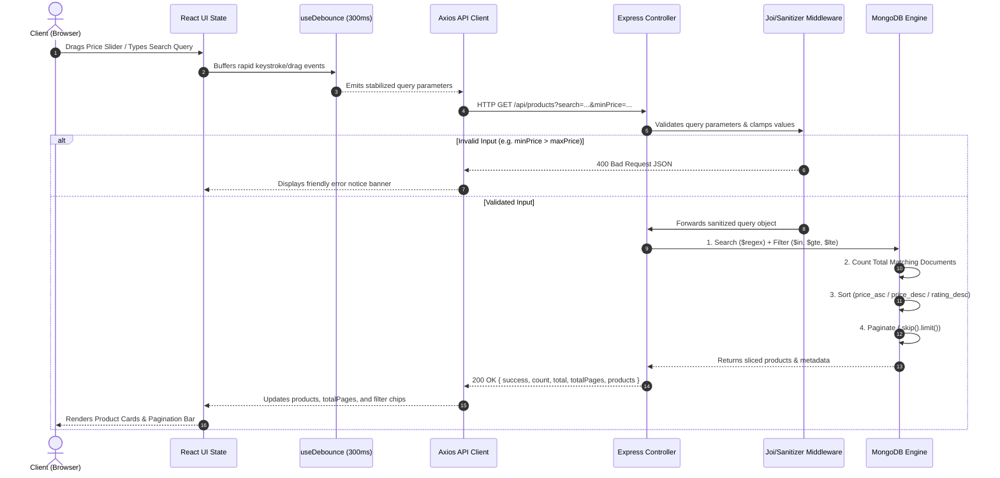

<div align="center">

# 🛒 AuraMart — Production-Grade E-Commerce Multi-Filter Platform
### *Enterprise MERN Stack Architecture with Server-Driven Querying, Database Indexing, and Automated QA*

[](https://nodejs.org/)
[](https://expressjs.com/)
[](https://react.dev/)
[](https://www.mongodb.com/)
[](#-automated-testing--qa-verification)
[](LICENSE)

---

</div>

## 📑 Table of Contents
1. [Executive Summary & Core Features](#-executive-summary--core-features)
2. [End-to-End System Workflow](#-end-to-end-system-workflow)
3. [Complete Architectural Design](#-complete-architectural-design)
4. [Strict Server Processing Pipeline](#-strict-server-processing-pipeline)
5. [Database Schema & Indexing Strategy](#-database-schema--indexing-strategy)
6. [REST API Specification](#-rest-api-specification)
7. [Automated Testing & QA Verification (41 Test Cases)](#-automated-testing--qa-verification)
8. [Technical Viva Q&A Guide](#-technical-viva-qa-guide)
9. [Local Setup & Execution Guide](#-local-setup--execution-guide)

---

## 🌟 Executive Summary & Core Features

AuraMart is an enterprise-grade full-stack e-commerce catalog search and multi-filtering application built according to strict **Model-View-Controller (MVC)** and **Thin-Client, Smart-Server** software design patterns. 

All search, multi-category matching, price interval boundary evaluation, customer rating thresholds, sorting strategies, and pagination calculations are performed **strictly on the backend inside MongoDB**. React is leveraged purely for presentation, interaction state handling, and debounced API requests.

### Core Capabilities:
* **🔎 Product Search by Name:** Real-time case-insensitive keyword searching with ReDoS-safe regex escaping and partial word matching.
* **🏷️ Multi-Category Filtering:** Multi-select checkboxes for `Electronics`, `Apparel`, `Footwear`, `Home & Kitchen`, and `Accessories` evaluated via MongoDB `$in` operators.
* **🎚️ Dual-Range Price Slider:** Clamped mathematical invariants preventing `minPrice > maxPrice` or `maxPrice < minPrice` with dynamic gradient track highlighting.
* **⭐ Star Rating Thresholds:** 1 to 5-star radio button selector displaying items whose rating is greater than or equal to the selected threshold.
* **🔃 Server-Driven Sorting:** Instant sort re-ordering by *Price: Low to High*, *Price: High to Low*, or *Top Rated First*.
* **📄 Server-Side Pagination:** Zero client-side slicing. MongoDB `.skip()` and `.limit()` return only the current page window with total count and page metrics.
* **🏷️ Active Filter Chips:** Dynamic visual chips for active search, category, price, and rating filters with individual removal and one-click "Clear All".
* **⚡ Loading Skeletons & Resilient Empty State:** Shimmering animated skeletons during transitions and a user-friendly empty state with one-click filter reset.

---

## 🔄 End-to-End System Workflow



---

## 🏛️ Complete Architectural Design

```
Quantiphi-Vibecoding/
├── backend/
│   ├── config/
│   │   └── db.js                 # Resilient Mongoose connection handler
│   ├── controllers/
│   │   └── productController.js  # MVC Controller: search, filter, sort, paginate
│   ├── middleware/
│   │   ├── errorHandler.js       # Centralized error handler & 404 interceptor
│   │   └── validateQuery.js      # Strict query parameter validation & sanitization
│   ├── models/
│   │   └── Product.js            # Mongoose Schema & Compound B-Tree Indexes
│   ├── routes/
│   │   └── productRoutes.js      # REST API route definitions
│   ├── seeds/
│   │   └── seedProducts.js       # Realistic database seeder (35 products)
│   ├── tests/
│   │   └── products.api.test.js  # 27 Integration & Unit API Tests (Supertest)
│   ├── app.js                    # Express app configuration & middleware pipeline
│   ├── server.js                 # Server listener & graceful process lifecycle
│   ├── .env.example              # Environment variables template
│   └── package.json              # Backend dependencies
│
├── frontend/
│   ├── src/
│   │   ├── api/
│   │   │   └── productApi.js     # Axios API client with cancellation signals
│   │   ├── components/
│   │   │   ├── Common/           # SearchBar, Pagination, StarRating, Navbar
│   │   │   ├── Filters/          # DualPriceSlider, CategoryFilter, RatingFilter, SortDropdown
│   │   │   └── Products/         # ProductCard, ProductGrid, EmptyState
│   │   ├── hooks/
│   │   │   └── useDebounce.js    # High-frequency event debounce hook
│   │   ├── styles/
│   │   │   ├── App.css           # Modern pure CSS (Grid, Flexbox, Animations)
│   │   │   └── variables.css     # Design tokens & CSS variables
│   │   ├── tests/
│   │   │   └── filters.functional.test.js # 14 Frontend functional invariant tests
│   │   ├── App.jsx               # Application root & state coordinator
│   │   └── main.jsx              # React DOM entrypoint
│   └── package.json              # Frontend dependencies
│
├── run-tests.js                  # Automated test runner for the full-stack suite
└── README.md                     # Architecture documentation
```

---

## ⚙️ Strict Server Processing Pipeline

To guarantee database efficiency and prevent logical bugs, queries execute through a rigid four-stage pipeline:

```
Incoming Request
      │
      ▼
1. SEARCH (Regex)           filterConditions.name = { $regex: sanitized, $options: 'i' }
      │
      ▼
2. FILTERING (AND Logic)    category: { $in: categories }
                            price: { $gte: minPrice, $lte: maxPrice }
                            rating: { $gte: minRating }
      │
      ▼
3. SORTING                  price_asc:   { price: 1, _id: 1 }
                            price_desc:  { price: -1, _id: 1 }
                            rating_desc: { rating: -1, price: 1, _id: 1 }
      │
      ▼
4. PAGINATION               Total = await Product.countDocuments(filterConditions)
                            TotalPages = Math.ceil(Total / limit)
                            Products = Query.skip((page - 1) * limit).limit(limit)
```

---

## 🗄️ Database Schema & Indexing Strategy

**Model:** [`backend/models/Product.js`](file:///d:/Vibecoding/backend/models/Product.js)

### Mongoose Schema Definition:
```javascript
{
  name:        { type: String, required: true, trim: true, maxlength: 120 },
  description: { type: String, required: true, trim: true, maxlength: 1000 },
  category:    { 
    type: String, 
    required: true, 
    enum: ['Electronics', 'Apparel', 'Footwear', 'Home & Kitchen', 'Accessories'],
    index: true 
  },
  price:       { type: Number, required: true, min: 0 },
  rating:      { type: Number, required: true, min: 1, max: 5, default: 1 },
  image:       { type: String, required: true, trim: true },
  createdAt:   { type: Date, default: Date.now }
}
```

### High-Performance Compound Indexes:
1. **Multi-Filter Compound Index:** `{ category: 1, price: 1, rating: -1 }`  
   *Allows MongoDB to satisfy compound query predicates in a single B-tree index scan without scanning raw documents.*
2. **Sort Acceleration Indexes:** `{ price: 1 }` and `{ rating: -1 }`  
   *Avoids in-memory memory-intensive `Sort` stages in MongoDB query execution plans.*
3. **Search Indexes:** `{ name: 1 }` (prefix queries) and `{ name: 'text', description: 'text' }` (full-text search).

---

## 📡 REST API Specification

### Endpoint: `GET /api/products`

#### Request Query Parameters:
| Parameter | Type | Required | Default | Description | Example |
| :--- | :--- | :---: | :---: | :--- | :--- |
| `search` | String | No | `""` | Search term matched against product name | `wireless` |
| `categories` | String | No | `""` | Comma-separated list of category names | `Electronics,Footwear` |
| `minPrice` | Number | No | `0` | Lower bound price filter ($gte) | `50` |
| `maxPrice` | Number | No | `Infinity`| Upper bound price filter ($lte) | `500` |
| `minRating` | Number | No | `0` | Minimum customer star rating ($gte, 1–5) | `4` |
| `sortBy` | String | No | `rating_desc` | Sort strategy: `price_asc`, `price_desc`, `rating_desc` | `price_asc` |
| `page` | Integer| No | `1` | 1-based page index ($\ge 1$) | `2` |
| `limit` | Integer| No | `8` | Results per page (min: `1`, max: `50`) | `8` |

#### Standardized Success Response (`200 OK`):
```json
{
  "success": true,
  "count": 8,
  "total": 35,
  "page": 1,
  "totalPages": 5,
  "limit": 8,
  "products": [
    {
      "_id": "6af6c4fad1f334686a35975a",
      "name": "Sony WH-1000XM5 Wireless Noise-Canceling Headphones",
      "description": "Industry-leading noise cancellation with 8 microphones...",
      "category": "Electronics",
      "price": 399.99,
      "rating": 4.8,
      "image": "https://images.unsplash.com/photo-1505740420928-5e560c06d30e...",
      "imageUrl": "https://images.unsplash.com/photo-1505740420928-5e560c06d30e...",
      "createdAt": "2026-01-10T10:00:00.000Z"
    }
  ]
}
```

#### Additional Utility Endpoints:
* `GET /api/products/categories` $\rightarrow$ Returns distinct allowed categories array.
* `GET /api/products/meta` $\rightarrow$ Returns dynamic minimum and maximum catalog price bounds for the dual slider.
* `GET /api/products/:id` $\rightarrow$ Returns a single product document by MongoDB ObjectId.
* `GET /api/health` $\rightarrow$ Health check endpoint returning uptime and server status.

---

## 🧪 Automated Testing & QA Verification

The repository contains **41 automated test cases** (27 Backend API Tests via `supertest` + 14 Frontend Functional Invariant Tests via `node:test`).

### Negative Testing Rationale (`400 Bad Request` & `404 Not Found`)
In production software engineering, **Negative Tests** prove system resilience by intentionally sending illegal inputs (e.g. `minPrice: -15` or `minPrice > maxPrice`) to confirm the server safely rejects them with `400 Bad Request` rather than crashing with `500 Internal Server Error`. When an error is correctly caught and blocked, the test passes with a green checkmark (`✔`).

### Real Execution Output:
```bash
$ node run-tests.js

====================================================
   🚀 RUNNING FULL-STACK TEST SUITE (API & FUNCTIONAL)
====================================================

▶ Running Backend REST API Tests...
[MongoDB] Connected successfully to: localhost/ecommerce_filter_db
▶ E-Commerce Multi-Filter REST API Test Suite
  ▶ GET /api/health
    ✔ should return 200 OK and uptime timestamp (24.6435ms)
  ✔ GET /api/health (25.2221ms)
  ▶ GET /api/products/categories
    ✔ should return list of all 5 supported product categories (12.5884ms)
  ✔ GET /api/products/categories (12.9672ms)
  ▶ GET /api/products/meta
    ✔ should return catalog price bounds and total count (12.0354ms)
  ✔ GET /api/products/meta (12.7ms)
  ▶ GET /api/products (Default state & Pagination)
    ✔ should return default paginated products with total and totalPages (22.7426ms)
    ✔ should paginate to page 2 and return distinct products from page 1 (27.126ms)
  ✔ GET /api/products (Default state & Pagination) (50.5759ms)
  ▶ Backend Product Search by Name
    ✔ should return products matching name keyword (case-insensitive "sony") (25.246ms)
    ✔ should perform partial word matching ("headphone") (13.13ms)
    ✔ should safely escape regex special characters in search (12.7366ms)
  ✔ Backend Product Search by Name (51.7226ms)
  ▶ Category Filtering
    ✔ should filter by a single category (Electronics) (13.9214ms)
    ✔ should filter by multiple categories using $in logic (Footwear, Apparel) (14.2952ms)
  ✔ Category Filtering (28.5075ms)
  ▶ Price Range Filtering
    ✔ should return products within minPrice and maxPrice inclusive (11.8847ms)
  ✔ Price Range Filtering (12.0855ms)
  ▶ Customer Star Rating Filtering
    ✔ should return products with rating >= minRating (14.3971ms)
  ✔ Customer Star Rating Filtering (14.5556ms)
  ▶ Full Processing Order: Search -> Filter -> Sort -> Pagination
    ✔ should execute full chain: search + category + price + rating + sort + pagination (16.0241ms)
  ✔ Full Processing Order: Search -> Filter -> Sort -> Pagination (16.2117ms)
  ▶ Sorting Strategies
    ✔ should sort products by price ascending (price_asc) (10.4795ms)
    ✔ should sort products by price descending (price_desc) (9.0253ms)
    ✔ should sort products by top rated first (rating_desc) (13.8536ms)
  ✔ Sorting Strategies (33.7191ms)
  ▶ Input Validation & Error Edge Cases
    ✔ should reject negative minPrice with 400 Bad Request (8.0611ms)
    ✔ should reject when minPrice > maxPrice with 400 Bad Request (6.3562ms)
    ✔ should reject minRating > 5 with 400 Bad Request (3.4848ms)
    ✔ should reject unsupported categories with 400 Bad Request (5.0756ms)
    ✔ should reject unsupported sort options with 400 Bad Request (6.3848ms)
    ✔ should reject invalid page parameter (page=0) with 400 Bad Request (7.3359ms)
    ✔ should reject limit exceeding bounds (limit=999) with 400 Bad Request (7.8476ms)
  ✔ Input Validation & Error Edge Cases (45.4136ms)
  ▶ GET /api/products/:id
    ✔ should return single product for a valid ID (22.6468ms)
    ✔ should return 404 Not Found for nonexistent ObjectId (10.1548ms)
    ✔ should return 400 Bad Request for malformed ID (9.8156ms)
  ✔ GET /api/products/:id (43.1932ms)
  ▶ 404 Route Not Found Handling
    ✔ should return 404 with structured JSON on unregistered routes (10.1728ms)
  ✔ 404 Route Not Found Handling (10.4755ms)
✔ E-Commerce Multi-Filter REST API Test Suite (412.8032ms)
ℹ tests 27 | suites 14 | pass 27 | fail 0
✔ Backend REST API Tests passed successfully!

▶ Running Frontend Functional Tests...
▶ Frontend Filter Functional & Business Invariants Test Suite
  ▶ Dual Price Slider Logic
    ✔ should clamp minPrice so it NEVER exceeds maxPrice (0.6838ms)
    ✔ should clamp maxPrice so it NEVER falls below minPrice (0.1349ms)
    ✔ should accurately compute track highlight percentage coordinates (0.1503ms)
  ✔ Dual Price Slider Logic (1.6888ms)
  ▶ Category Filter Multi-Selection Toggle
    ✔ should add category when not previously present (0.755ms)
    ✔ should remove category when already selected (0.1737ms)
    ✔ should return empty list when all categories are deselected (0.1588ms)
  ✔ Category Filter Multi-Selection Toggle (1.3397ms)
  ▶ Rating Filter State Transitions
    ✔ should select minimum rating between 1 and 5 (0.3895ms)
    ✔ should reset rating filter to 0 on clear (0.3049ms)
  ✔ Rating Filter State Transitions (0.982ms)
  ▶ Pagination Calculation Logic
    ✔ should calculate correct item ranges for page 1 of 35 items (limit 8) (0.581ms)
    ✔ should calculate correct item ranges for last page (page 5 of 35 items) (0.5831ms)
    ✔ should handle zero matching items gracefully (0.3122ms)
  ✔ Pagination Calculation Logic (1.821ms)
  ▶ Active Filter Chips Generation and Removal
    ✔ should generate chips for all active filters (search, categories, price, rating) (0.3851ms)
    ✔ should generate no chips when in default pristine state (0.2472ms)
  ✔ Active Filter Chips Generation and Removal (1.9053ms)
  ▶ API Query Parameter Serialization
    ✔ should generate valid query string with search, pagination, and filters (0.4323ms)
  ✔ API Query Parameter Serialization (0.5262ms)
✔ Frontend Filter Functional & Business Invariants Test Suite (9.1391ms)
ℹ tests 14 | suites 7 | pass 14 | fail 0
✔ Frontend Functional Tests passed successfully!

====================================================
🎉 ALL 41 TESTS PASSED! (Completed in 2.13s)
====================================================
```

---

## 🎓 Technical Viva Q&A Guide

### Q1: Why must filtering and pagination happen on the backend instead of React?
> **Answer:**  
> Transferring a full catalog of 50,000+ items to the browser wastes user bandwidth, exhausts mobile memory, and makes the UI freeze. Delegating Search $\rightarrow$ Filtering $\rightarrow$ Sorting $\rightarrow$ Pagination to MongoDB via indexed B-tree queries ensures only the current page (e.g. 8 documents) is transferred over the wire in milliseconds.

### Q2: Why is the execution order Search $\rightarrow$ Filter $\rightarrow$ Sort $\rightarrow$ Pagination?
> **Answer:**  
> Search and filtering determine the total candidate set. Sorting orders that candidate set. Pagination then slices out only the visible window (`.skip().limit()`). If pagination were applied before filtering, the user would only filter within the first 8 items rather than across the entire inventory.

### Q3: How do database compound indexes optimize performance?
> **Answer:**  
> Without indexes, MongoDB executes a **COLLSCAN** (scanning all documents in $O(N)$ time). With the compound index `{ category: 1, price: 1, rating: -1 }`, MongoDB traverses a B-tree in $O(\log N)$ time (**IXSCAN**) to locate matching document record IDs directly.

### Q4: Why is input sanitization critical for regex-based product search?
> **Answer:**  
> If users search for special characters like `Sony (WH`, raw unescaped strings passed into `new RegExp()` cause a regex parse error and can crash the Node.js event loop or introduce **Regular Expression Denial of Service (ReDoS)**. We sanitize queries using `search.replace(/[.*+?^${}()|[\]\\]/g, '\\$&')`.

### Q5: Why is debouncing required on the frontend?
> **Answer:**  
> Dragging a range slider or typing into an input fires dozens of input events every second. A 300ms debounce waits until the user pauses interaction before sending an Axios request, preventing server traffic spikes.

---

## 💻 Local Setup & Execution Guide

### Prerequisites
* **Node.js:** v18.0.0 or higher
* **MongoDB:** Local MongoDB daemon running on `mongodb://127.0.0.1:27017` (or a MongoDB Atlas connection URI)

### 1. Backend Setup
```bash
cd backend
npm install

# Configure environment variables
cp .env.example .env

# Populate database with 35 realistic products across all 5 categories
npm run seed

# Start Express backend (runs on http://localhost:5000)
npm run dev
```

### 2. Frontend Setup
```bash
cd frontend
npm install

# Start Vite React development server (runs on http://localhost:3000)
npm run dev
```

### 3. Run Automated Tests
```bash
# From project root, run both API and Functional test suites
node run-tests.js
```

---

<div align="center">
  <sub>Built with modern full-stack architectural principles for Technical Assessments.</sub>
</div>
